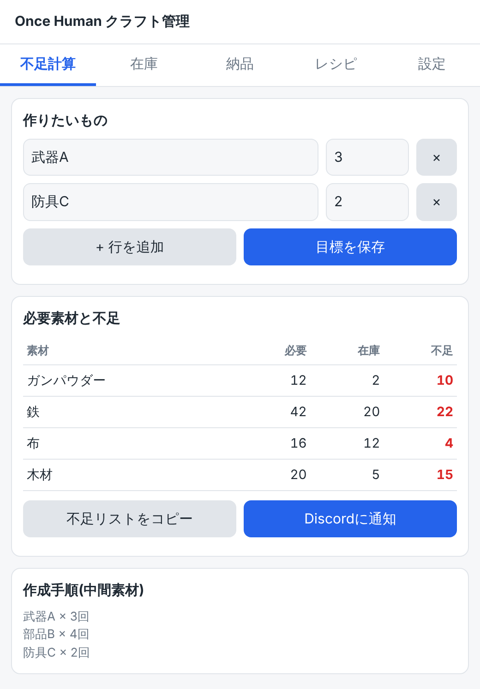
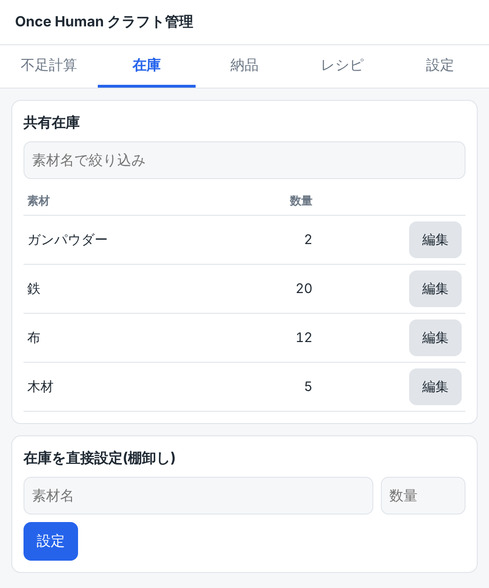
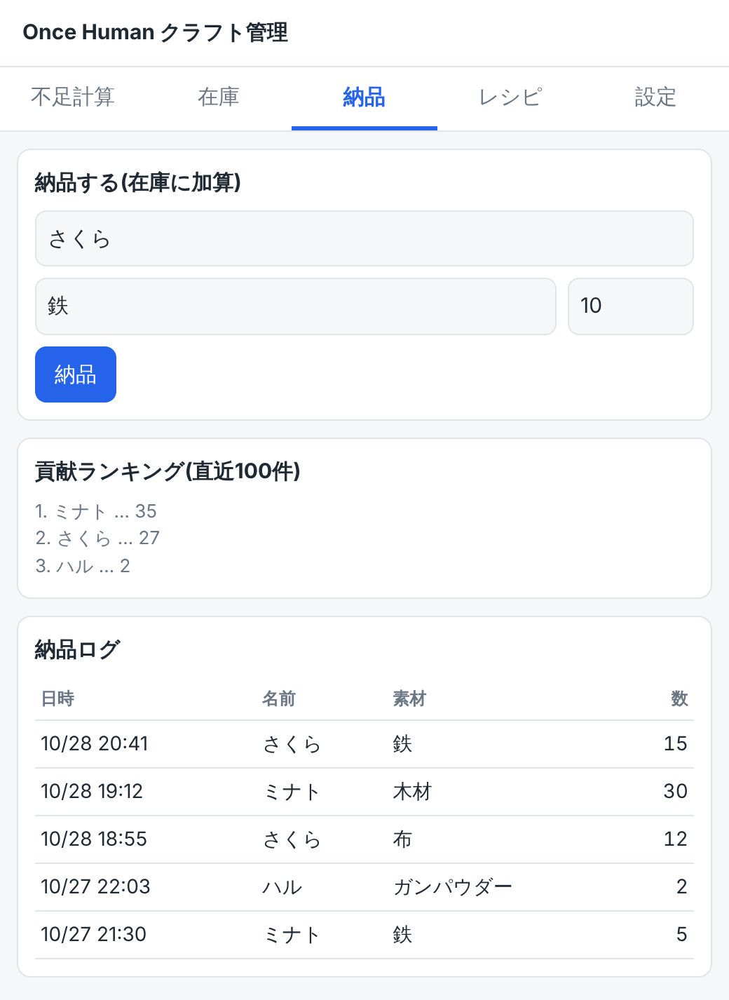
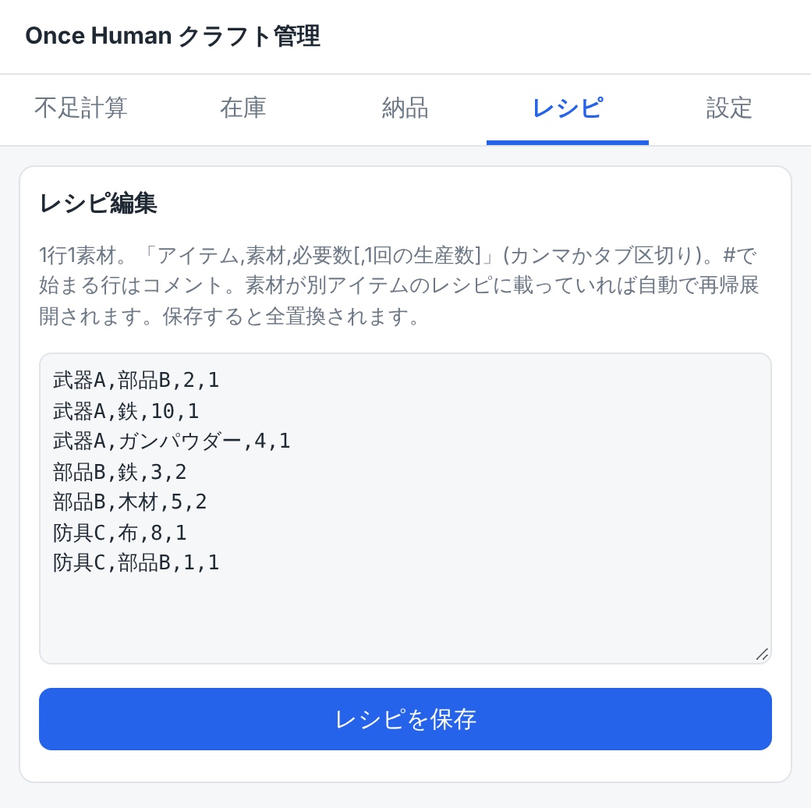
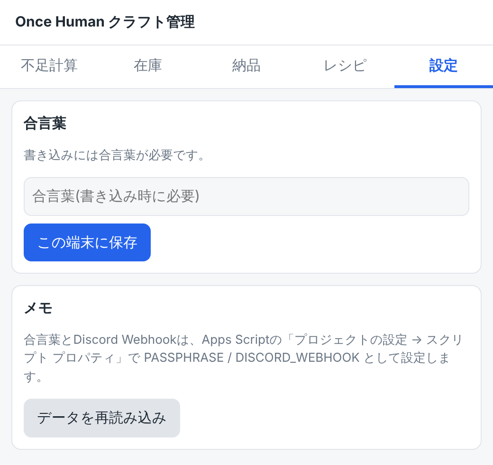

# 使い方(howtouse.md)

Once Human クラフト管理アプリの画面ごとの操作ガイドです。画面上部のタブ(**不足計算 / 在庫 / 納品 / レシピ / 設定**)で切り替えます。

> 画像はサンプルデータの表示例です。画像はリポジトリ直下の `img/` ディレクトリに置いてください。

## 全体の流れ

1. 管理者が **レシピ** タブでゲームのレシピを登録する(最初の1回)
2. メンバーが素材を集めたら **納品** タブで報告する
3. **不足計算** タブで「作りたいもの」を入力すると、足りない素材が分かる
4. 不足リストをDiscordに共有して、手分けして集める

---

## 1. 不足計算タブ

作りたいアイテムから、必要な素材と不足数を調べる画面です。



### 作りたいもの
| 部品 | 説明 |
|---|---|
| アイテム名 | 入力欄をクリックすると、レシピ登録済みのアイテムが候補に出ます |
| 個数 | 作りたい数(1以上) |
| **×** | その行を削除 |
| **+ 行を追加** | 作りたいアイテムを複数登録できます |
| **目標を保存** | 現在の入力をスプレッドシートに保存。他のメンバーが開いたときも同じ目標が表示されます |

入力するたびに、下の表が自動で更新されます。**目標は「目標を保存」を押すまで他の人には共有されません。**

### 必要素材と不足
| 列 | 意味 |
|---|---|
| 素材 | 最終的に必要になる素材(中間素材は含まず、元になる素材だけ) |
| 必要 | 在庫がゼロだった場合に必要な総数 |
| 在庫 | 共有在庫の現在数 |
| 不足 | 足りない数。**赤字**は不足、緑の **OK** は足りています |

- 中間素材(他のレシピで作れる素材)は、その在庫があれば**先に消費**した前提で計算されます。
- 完成品の在庫があれば、その分は作らなくて済む計算になります。

### ボタン
- **不足リストをコピー**:不足している素材を文章にしてクリップボードにコピーします(Discordにそのまま貼れます)。
- **Discordに通知**:同じ文章をDiscordへ送ります。管理者が `DISCORD_WEBHOOK` を設定したときだけ表示されます。

### 作成手順(中間素材)
作る必要がある中間素材と回数を表示します。例:`部品B × 3回`。

---

## 2. 在庫タブ

チーム共有倉庫の素材数を確認・修正する画面です。



### 共有在庫
- **素材名で絞り込み**:入力した文字を含む素材だけを表示します。
- 各行の **編集** ボタンを押すと、下の「在庫を直接設定」欄に素材名と現在数が入ります。

### 在庫を直接設定(棚卸し)
1. 素材名と数量を入力(素材名は候補から選べます)
2. **設定** を押す

入力した数量で**上書き**されます(加算ではありません)。次のような場合に使います。
- ゲーム内の倉庫の実数と合わせたいとき
- クラフトで素材を消費したあと、在庫を減らしたいとき

> **注意**:クラフトしても在庫は自動では減りません。使った分は棚卸しで反映してください。

---

## 3. 納品タブ

素材を倉庫に入れたときに報告する画面です。



### 納品する(在庫に加算)
1. **メンバー名**を入力(一度入力すると、この端末に記憶されます)
2. **素材名**と**数量**を入力
3. **納品** を押す

在庫に**加算**され、納品ログにも記録されます。

### 貢献ランキング(直近100件)
メンバーごとの納品数量の合計を多い順に表示します。素材の種類に関係なく、数量をそのまま合計した数です。

### 納品ログ
日時・名前・素材・数量を新しい順に表示します。

---

## 4. レシピタブ

クラフトのレシピを編集する画面です。管理者向けです。



### 書き方
1行に1素材、カンマ(またはタブ)区切りで入力します。

```
# アイテム,素材,必要数,1回の生産数(省略時は1)
武器A,部品B,2
武器A,鉄,10
部品B,鉄,3,2
部品B,木材,5,2
```

- 「武器A を1個作るには、部品B 2個と鉄10個」という意味です。
- 末尾の数字は「1回のクラフトで何個できるか」です。上の例では、部品Bは1回で2個できます。
- `#` で始まる行はコメントです。空行は無視されます。
- 素材が別アイテムのレシピに載っていれば、自動で中間素材として展開されます。

### 保存
**レシピを保存** を押すと確認が出ます。保存すると**レシピ全体が置き換わる**ので、既存の内容を消さないよう、編集前の内容を残したまま追記・修正してください。形式が違う行があると、何行目が原因かを表示して保存を中止します。

---

## 5. 設定タブ



### 合言葉
管理者が `PASSPHRASE` を設定している場合、書き込み(納品・在庫設定・レシピ保存・目標保存・通知)に合言葉が必要です。

1. 合言葉を入力
2. **この端末に保存** を押す

以降、この端末では入力不要です。合言葉が違うと「合言葉が違います」と表示されます。閲覧は合言葉なしでできます。

### データを再読み込み
他のメンバーの更新を反映したいときに押します。納品・在庫設定のあとは自動で再読み込みされます。

---

## 画面下のメッセージ
操作の結果は、画面下に数秒表示されます。**緑**は成功、**赤**はエラーです。赤の場合は、メッセージの内容(合言葉の誤り、入力不備など)を確認してください。

## よくある質問

**Q. 不足計算で「不足」がすべて OK になりました。**
A. 在庫が足りています。作成手順(中間素材)の欄で、先に作る中間素材と回数を確認してください。

**Q. アイテム名の候補が出ません。**
A. レシピタブにそのアイテムが登録されていません。レシピを追加してください。

**Q. 他の人の納品が反映されません。**
A. 設定タブの「データを再読み込み」を押してください。

**Q. 間違えて納品してしまいました。**
A. 在庫タブの「在庫を直接設定」で正しい数に直してください。納品ログは、スプレッドシートの「納品ログ」タブで該当行を直接削除できます。
